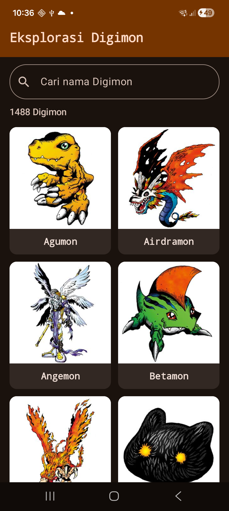
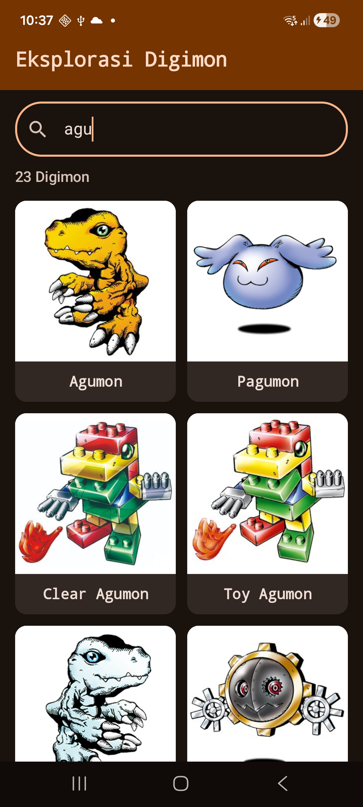
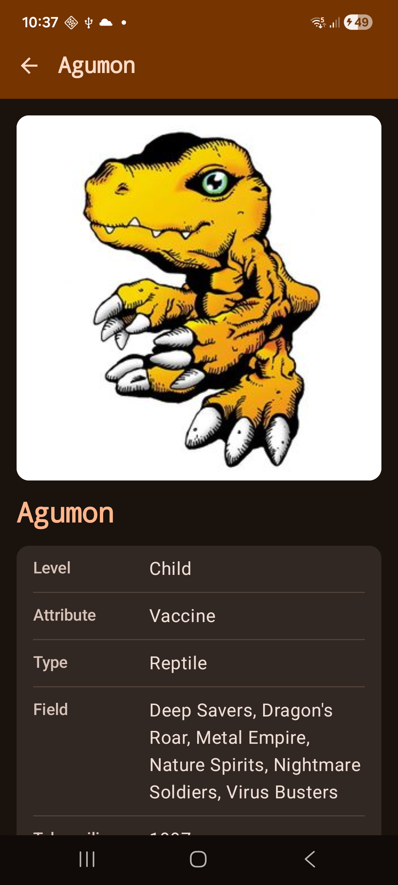
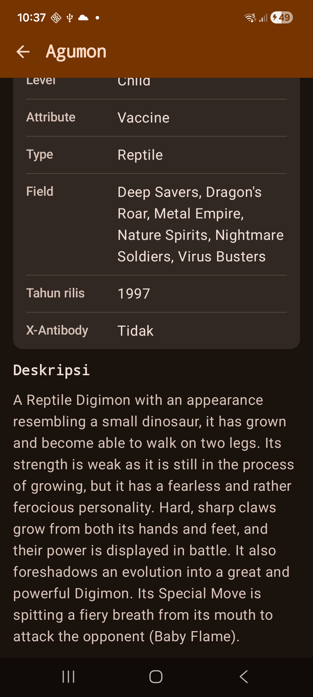
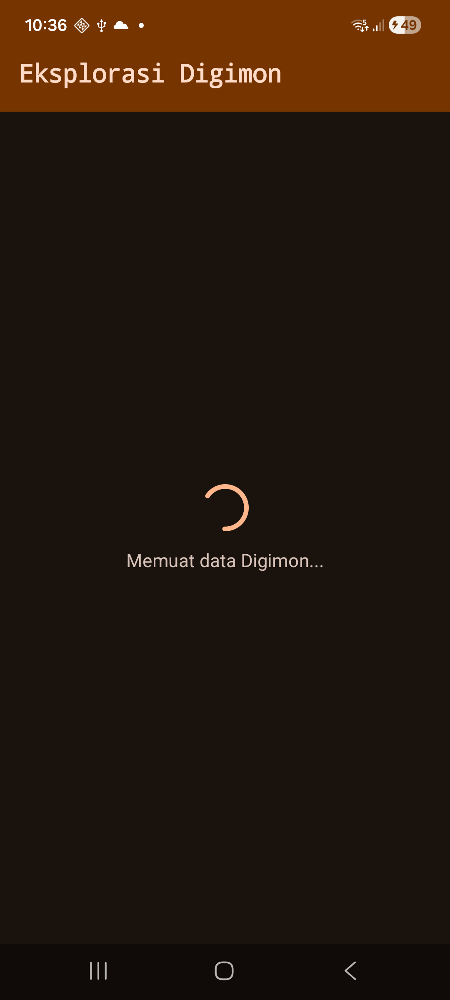
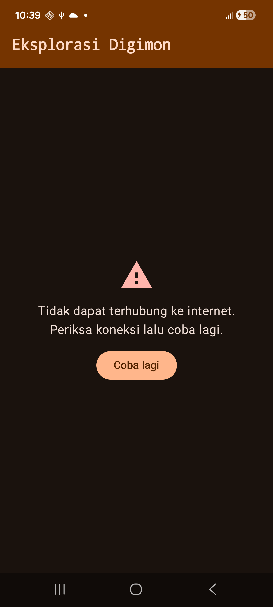

# Eksplorasi Digimon

Responsi Praktikum Pemrograman Mobile, Paket D.

| | |
|---|---|
| Nama | Hafizh Naufal Raditya |
| NIM | H1D024061 |
| Shift | A |

Aplikasi Android untuk melihat daftar Digimon dan informasi detailnya. Seluruh data diambil dari [Digi-API](https://digi-api.com).

## Screenshot

| Daftar Digimon | Pencarian | Detail Digimon |
|---|---|---|
|  |  |  |

| Detail (lanjutan) | Loading | Error |
|---|---|---|
|  |  |  |

## Fitur

- Menampilkan seluruh Digimon dari API dalam bentuk grid (gambar dan nama).
- Mencari Digimon berdasarkan nama.
- Menampilkan detail Digimon: nama, level, attribute, type, field, tahun rilis, X-Antibody, dan deskripsi.
- Tampilan loading saat data sedang diambil.
- Tampilan error dengan tombol "Coba lagi" saat data gagal diambil.
- Mendukung mode terang dan mode gelap.

## Teknologi

| Kebutuhan | Yang dipakai |
|---|---|
| Bahasa | Kotlin |
| UI | Jetpack Compose, Material Design 3 |
| Navigasi | Navigation Compose |
| Arsitektur | MVVM dengan Repository |
| Networking | Retrofit dan Gson |
| Gambar | Coil |
| State | StateFlow dan `sealed interface UiState` |

## Struktur Folder

```
app/src/main/java/com/pemmob1/h1d024061/responsi/
├── MainActivity.kt
├── data/
│   ├── model/Digimon.kt                  Model
│   ├── remote/DigimonApi.kt              Retrofit (endpoint dan client)
│   └── repository/DigimonRepository.kt   Repository
└── ui/
    ├── state/UiState.kt                  State: Loading, Success, Error
    ├── viewmodel/
    │   ├── HomeViewModel.kt              ViewModel layar daftar
    │   └── DetailViewModel.kt            ViewModel layar detail
    ├── navigation/DigimonNavGraph.kt     Rute dan NavHost
    ├── screen/
    │   ├── HomeScreen.kt                 View: daftar Digimon
    │   └── DetailScreen.kt               View: detail Digimon
    ├── component/
    │   ├── DigimonCard.kt                Kartu satu Digimon
    │   └── StateViews.kt                 Tampilan loading, error, kosong
    └── theme/
        ├── Color.kt                      Warna tema
        ├── Type.kt                       Tipografi
        └── Theme.kt                      DigimonTheme
```

## Alur Data (MVVM)

```
View (Screen)  →  ViewModel  →  Repository  →  DigimonApi (Retrofit)  →  Digi-API
     ↑                │
     └── UiState ─────┘
```

1. Screen meminta ViewModel lewat `viewModel()`.
2. ViewModel memanggil Repository di dalam `viewModelScope.launch`.
3. Repository memanggil fungsi `suspend` milik `DigimonApi`.
4. Retrofit mengambil JSON dari Digi-API, lalu Gson mengubahnya menjadi data class.
5. ViewModel menyimpan hasilnya ke `MutableStateFlow` sebagai `UiState.Success`, atau `UiState.Error` kalau gagal.
6. Screen membaca `uiState` dengan `collectAsStateWithLifecycle()` dan menampilkan tampilan yang sesuai.

## Penjelasan Teknis

### Model (`data/model/Digimon.kt`)

- `DigimonListResponse` menampung respons endpoint daftar. Isinya `content`, yaitu list `Digimon`.
- `Digimon` adalah data satu Digimon di daftar: `id`, `name`, dan `image`.
- `DigimonDetail` adalah data lengkap satu Digimon. Level, type, attribute, dan field berupa list karena satu Digimon bisa punya lebih dari satu.
- Property yang bisa kosong dari API dibuat nullable (`String?`, `List<...>?`).
- `DigimonDetail` punya property bantu seperti `levelText`, `typeText`, `attributeText`, `imageUrl`, dan `description`. Property ini mengolah list menjadi teks siap tampil memakai `mapNotNull`, `joinToString`, `firstOrNull`, dan `orEmpty`. Kalau datanya kosong, teksnya menjadi "Tidak diketahui".

### Networking (`data/remote/DigimonApi.kt`)

- `DigimonApi` adalah interface Retrofit dengan dua endpoint:
  - `GET digimon?page=..&pageSize=..` untuk daftar Digimon.
  - `GET digimon/{id}` untuk detail satu Digimon.
- Kedua fungsi berupa `suspend fun` supaya tidak memblokir UI thread.
- `ApiClient` adalah `object` (singleton) yang membuat Retrofit satu kali dengan `by lazy`. Base URL-nya `https://digi-api.com/api/v1/` dan converter-nya Gson.
- Izin `INTERNET` ditambahkan di `AndroidManifest.xml`.

### Repository (`data/repository/DigimonRepository.kt`)

- Menjadi satu-satunya pintu ViewModel ke sumber data.
- `getDigimonList()` mengambil daftar dari API dan mengembalikan `content.orEmpty()`, sehingga ViewModel selalu menerima list, tidak pernah null.
- `getDigimonDetail(id)` mengambil detail satu Digimon.

### State (`ui/state/UiState.kt`)

- `sealed interface UiState<out T>` punya tiga keadaan: `Loading`, `Success(data)`, dan `Error(message)`.
- Karena `sealed`, `when` di Screen wajib menangani ketiganya.
- `Throwable.toUserMessage()` adalah extension function yang mengubah exception menjadi pesan yang mudah dipahami: `IOException` berarti masalah koneksi, `HttpException` berarti server menolak permintaan.

### ViewModel (`ui/viewmodel`)

- `HomeViewModel` menyimpan state daftar di `MutableStateFlow` yang private (`_uiState`) dan membukanya sebagai `StateFlow` (`uiState`). Data diambil di `init`, dan `loadDigimon()` bisa dipanggil lagi untuk mencoba ulang.
- `DetailViewModel` membaca `digimonId` dari `SavedStateHandle`, yaitu argumen rute navigasi, lalu mengambil detailnya.
- Pengambilan data dibungkus `try/catch` di dalam `viewModelScope.launch`. Sebelum mengambil data state diubah ke `Loading`, lalu menjadi `Success` atau `Error`.

### Navigation (`ui/navigation/DigimonNavGraph.kt`)

- `Routes` menyimpan nama rute: `home` dan `detail/{digimonId}`.
- `NavHost` punya dua tujuan sesuai ketentuan (maksimal 2 screen): Home dan Detail.
- Saat kartu ditekan, Home memanggil `onDigimonClick(id)` dan NavGraph menjalankan `navController.navigate(Routes.detail(id))`.
- `digimonId` dikirim sebagai argumen bertipe `NavType.IntType`.
- Tombol kembali memanggil `popBackStack(Routes.HOME, inclusive = false)`.

### View (`ui/screen` dan `ui/component`)

- Tiap layar dibagi dua: fungsi `...Screen` yang mengambil state dari ViewModel, dan fungsi `...Content` yang hanya menerima state dan lambda. Dengan begitu `...Content` bisa ditampilkan di Preview.
- `HomeScreen` memakai `Scaffold`, `TopAppBar`, `OutlinedTextField` untuk pencarian, dan `LazyVerticalGrid` dengan `GridCells.Adaptive` supaya jumlah kolom menyesuaikan lebar layar. Tiap item diberi `key` berupa id Digimon.
- Pencarian menyaring list dengan `filter` dan `contains(ignoreCase = true)`. Teks pencarian disimpan dengan `rememberSaveable`.
- `DetailScreen` menampilkan gambar dengan `AsyncImage` dari Coil, lalu informasi Digimon dalam `Card`.
- `DigimonCard` adalah kartu yang bisa ditekan, berisi gambar dan nama.
- `StateViews.kt` berisi `LoadingView`, `ErrorView`, dan `EmptyView` yang dipakai kedua layar.

### Theme (`ui/theme`)

- `Color.kt` berisi warna untuk mode terang dan mode gelap. Warna utamanya oranye, warna kedua biru.
- `Type.kt` berisi `DigimonTypography`: judul memakai `FontFamily.Monospace` dan isi memakai `FontFamily.SansSerif`.
- `Theme.kt` berisi `DigimonTheme` yang memilih `lightColorScheme` atau `darkColorScheme` mengikuti pengaturan HP, lalu membungkus aplikasi dengan `MaterialTheme`.

## Pemenuhan Persyaratan

| Persyaratan | Penerapan |
|---|---|
| Data class | `Digimon`, `DigimonDetail`, `UiState.Success`, dan lainnya |
| Null safety | Property nullable, `?.`, `?:`, `orEmpty()`, `takeIf` |
| Lambda | `onDigimonClick`, `onRetry`, `filter { }`, `mapNotNull { }` |
| Collection | `List`, `filter`, `mapNotNull`, `joinToString`, `firstOrNull` |
| Jetpack Compose | Seluruh UI, tanpa XML layout |
| Material Design 3 | `Scaffold`, `TopAppBar`, `Card`, `OutlinedTextField`, `Button` |
| Custom Theme | `DigimonTheme` dengan color scheme sendiri |
| Custom Typography | `DigimonTypography` |
| List | `LazyVerticalGrid` |
| Networking | Retrofit ke Digi-API |
| Data minimal | Nama, Level, Attribute, Type di layar detail |
| MVVM | Model, View, ViewModel, Repository |
| Navigation | 2 screen: Home dan Detail |
| State | `UiState`: Loading, Success, Error |

## Cara Menjalankan

1. Buka proyek di Android Studio.
2. Tunggu Gradle sync selesai.
3. Jalankan di emulator atau HP dengan koneksi internet aktif.
